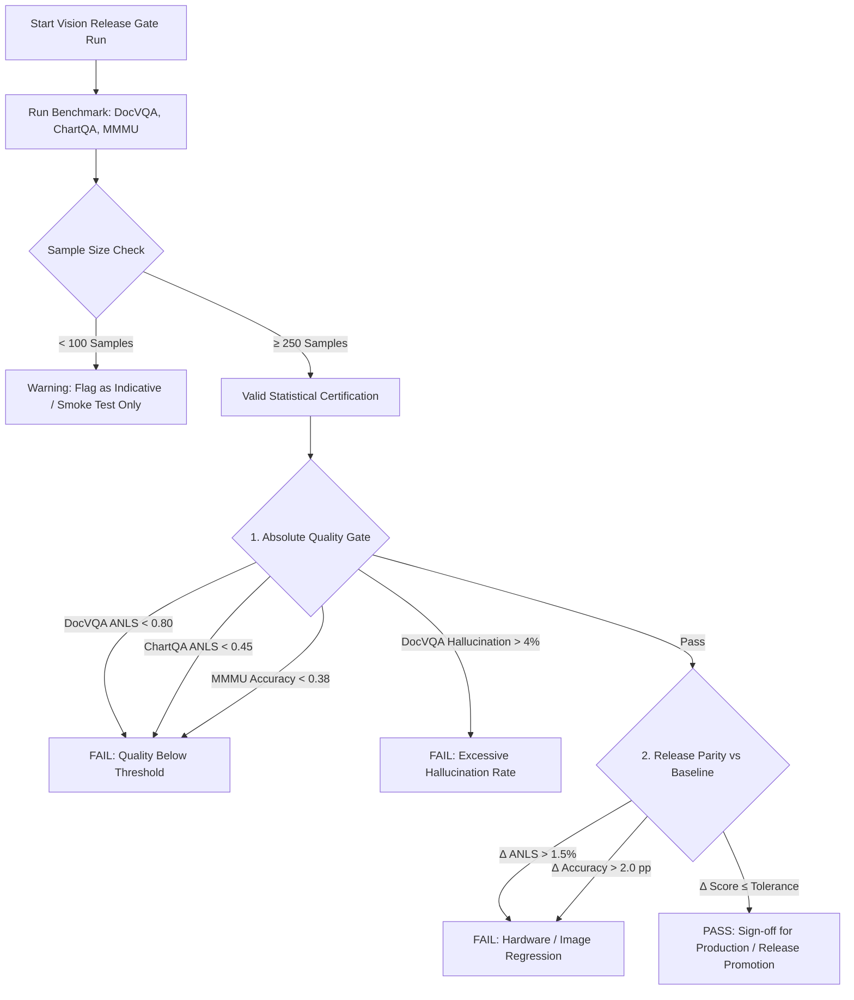
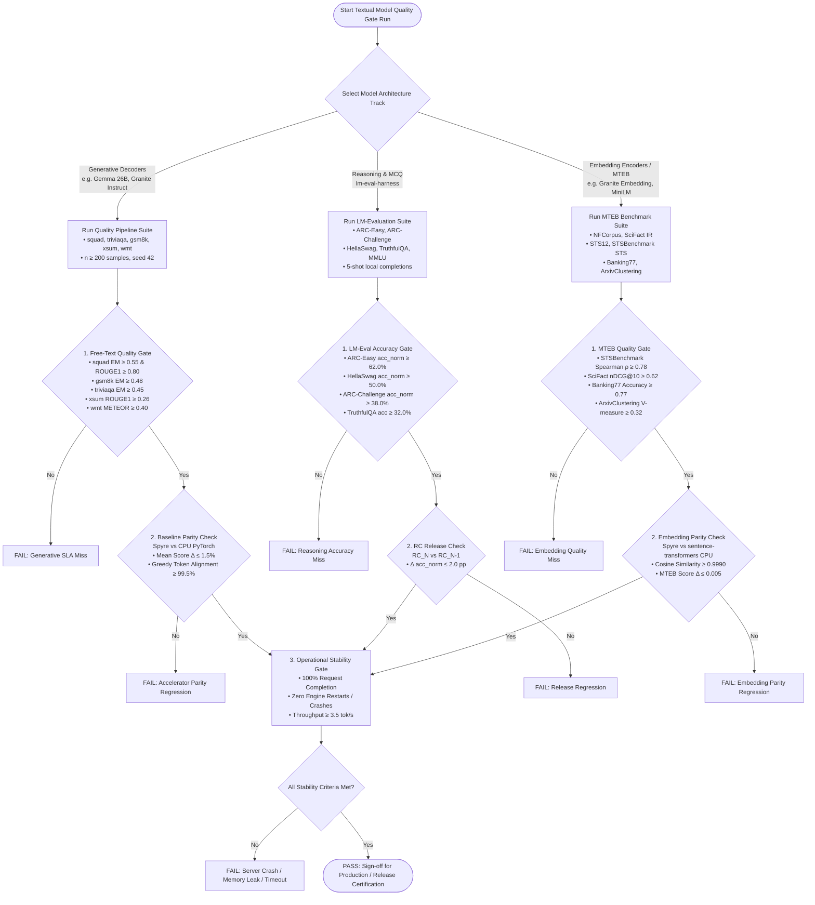

# RFC: Model Quality Gating and Production Workload Accuracy Framework for IBM Z + Spyre

**Authors:**
- [Mohini Shrivastava](https://github.com/Mohini-Shrivastava)
- [Antoni Viros i Martin](https://github.com/ani300)
- [Rishika Kedia] (https://github.com/rishikakedia)
- [Ajit Samuel John](https://github.com/ajitjohn05)

Tracking issue: (https://github.com/torch-spyre/torch-spyre/issues/5980)


---

## 1. Summary

This RFC specifies the comprehensive **Quality Gating, Accuracy Thresholds, and Parity Certification Framework** for deep learning models—including Multimodal Vision-Language Models (VLMs), Generative Decoders (LLMs), Standardized Reasoning Suites, and Dense Embedding Encoders (MTEB)—deployed on **IBM Z (s390x) + Spyre Accelerator** via **vLLM**. 

Additionally, this RFC formalizes the **Production Workload Shapes** (covering Claim Classification, Vision Damage Assessment, Structured Image Analysis, Document Summarization, Text/Image-Augmented RAG Q&A, and Ingestion/Embedding Pipelines) and establishes a rigorous **Workload-to-Accuracy-Gate Validation Matrix** to ensure that all production release candidates (`RC_N`) satisfy enterprise SLAs without regression.

---

## 2. Motivation & Problem Statement

Enabling generative and multimodal AI on specialized hardware accelerators (such as IBM Z with Spyre PCIe cards) requires verifying that:
1. **Numerical and Quantization Fidelity**: Model execution under hardware acceleration, custom kernels, and dynamic vLLM paged-attention schedules preserves quality compared to standard FP32/BF16 CPU golden references ($\Delta \le 1.5\%$).
2. **Deterministic Release Verification**: Container release updates (e.g., `RC10` $\rightarrow$ `RC11`) must undergo automated quality gating to prevent silent regressions in domain comprehension, numerical chart reasoning, or text generation.
3. **Workload-Specific Alignment**: Generic perplexity or rough BLEU scores do not capture real-world enterprise workload behaviors (e.g., unit hallucinations in financial charts, false refusals in scanned invoices, or context truncation in 20k-character RAG pipelines).

### Key Gaps Identified in Prior Release Reports
* **Sample Size Sensitivity**: Evaluating only $n = 50$ samples yields wide 95% confidence intervals ($\pm 14\text{ pp}$), creating risk of mistaking statistical noise for genuine hardware regressions.
* **Token-Forcing Distortions**: Forcing `max_new_tokens = 1` on multiple-choice tasks (MMMU) introduces artificial first-character biases (e.g., 60% skew towards `"A"`).
* **Missing Workload Grounding**: Prior benchmarks lacked direct mappings to enterprise production shapes (e.g., Insurance Claim Classification, Ingestion OCR, RAG Q&A).

---

## 3. Production Workload Specifications & Input/Output Shapes

The gating framework validates the following production deployment profiles on IBM Z + Spyre:

### 3.1 Gemma 4 26B-A4B (MoE) Workloads

| Use Case | Modality / Shape | Batch Size | Prompt Tokens | Decode Tokens |
| :--- | :--- | :--- | :--- | :--- |
| **Claim Classification** | Text-only | 1 | $\sim 450\text{--}600$ | 64 |
| **Vision Damage Assessment** | Multimodal (image + text) | 1 | $\sim 200\text{ text} + \text{image tokens}$ | 512 |
| **Structured Image Analysis** | Multimodal (image + text) | 1 | $\sim 150\text{ text} + \text{image tokens}$ | 128 |
| **LLM Explainability** | Text-only | 1 | Variable, capped at $\sim 2{,}048$ | 512 default; max 1024 |

---

### 3.2 Granite 3.3 8B Instruct Workloads

| Use Case | Modality / Shape | Batch Size | Prompt Tokens | Decode Tokens |
| :--- | :--- | :--- | :--- | :--- |
| **Claim Classification** | Text-only | 1 | $\sim 450\text{--}600$ | 64 |
| **Vision Damage Assessment** | Multimodal (image + text) | 1 | $\sim 200\text{ text} + \text{image tokens}$ | 512 |
| **Structured Image Analysis** | Multimodal (image + text) | 1 | $\sim 150\text{ text} + \text{image tokens}$ | 128 |
| **LLM Explainability** | Text-only | 1 | Variable, capped at $\sim 2{,}048$ | 512 default; max 1024 |
| **Document Summarization** | Text-only | 1 | Variable, capped at $\sim 4{,}050$ (cut to 16,000 chars + 200-char prompt) | 768 (compose); 512 if unset |
| **Text RAG Q&A** | Text-only | 1 | Variable, capped at $\sim 5{,}000$ (`MAX_PROMPT_LENGTH` = 20,000 chars) | 768 default; $\sim 998$ (FR), $\sim 1{,}382$ (HI) |
| **Image-Augmented RAG Q&A** | Text-only (captions injected) | 1 | Variable, capped at $\sim 5{,}000$ (with 1–3 image captions in context) | 768 default (same language scaling) |

---

### 3.3 Specialized Ingestion, Captioning & Embedding Models

| Use Case | Model | Modality / Shape | Batch Size | Prompt Tokens | Decode Tokens |
| :--- | :--- | :--- | :--- | :--- | :--- |
| **Image Captioning at Ingest** | `Granite Vision 3.3-2B` | Multimodal (image + text) | 1 | $\sim 8\text{ text tokens}$ (`"<image>\nDescribe this image in detail:"`) + image tokens | 100 (`max_new_tokens`) |
| **Document & Query Embedding**| `Granite Embedding 278M multilingual` | Text-only | Per chunk | Chunk size (`CHUNK_SIZE=25`, `CHUNK_OVERLAP=4`) | None (embedding vector only) |

---

## 4. Generic, Model-Agnostic Use-Case Gating Framework

To ensure that evaluation is durable, scalable, and independent of specific model architectures (e.g. dense models, Mixture of Experts, encoder-only, or vision transformers), this section establishes a **generalized, use-case-centric framework**. Any model deployed on IBM Z + Spyre is classified into one of the standardized **Enterprise Workload Archetypes** below and must satisfy its corresponding SLA criteria.

### 4.1 Enterprise Use-Case Archetypes & Universal Gating Standards

| Archetype ID | Use-Case Archetype | Input Context & Modality | Output Shape | Primary Metrics & Universal SLA Gate | Hardware Parity Tolerance ($\Delta$) |
| :--- | :--- | :--- | :--- | :--- | :--- |
| **UC-ARCH-01** | **Short-Form Intent & Classification**<br>*(e.g., Claim Routing, Triage, Intent)* | Text-only<br>($200\text{--}600$ tokens) | Constrained token<br>($16\text{--}64$ tokens) | **Accuracy** $\ge \mathbf{0.75}$<br>**Normalized EM** $\ge \mathbf{0.80}$<br>Zero JSON/schema format corruption | $\Delta \text{ Accuracy} \le \mathbf{1.0\%}$ |
| **UC-ARCH-02** | **Document Understanding & Layout Extraction**<br>*(e.g., Invoices, Forms, Tables)* | Multimodal<br>(Image + $150\text{--}250$ text) | Extractive text/JSON<br>($64\text{--}256$ tokens) | **ANLS** $\ge \mathbf{0.80}$<br>**Exact Match** $\ge \mathbf{0.75}$<br>**Hallucination Rate** $\le \mathbf{2.0\%}$ | $\Delta \text{ ANLS} \le \mathbf{0.5\%}$ |
| **UC-ARCH-03** | **Visual Data & Diagram Reasoning**<br>*(e.g., Damage Assessment, Chart Plots)* | Multimodal<br>(Image + $200\text{ tokens}$) | Numerical / Reasoning<br>($128\text{--}512$ tokens) | **Visual ANLS** $\ge \mathbf{0.70}$<br>**Categorical Acc** $\ge \mathbf{0.75}$<br>**Hallucination Rate** $\le \mathbf{3.0\%}$ | $\Delta \text{ Score} \le \mathbf{1.5\%}$ |
| **UC-ARCH-04** | **Contextual Synthesis & Summarization**<br>*(e.g., Case Summaries, Meeting Notes)* | Long Text<br>($2{,}000\text{--}8{,}000$ tokens) | Structured synthesis<br>($256\text{--}768$ tokens) | **ROUGE-1** $\ge \mathbf{0.26}$, **ROUGE-L** $\ge \mathbf{0.20}$<br>**METEOR** $\ge \mathbf{0.20}$<br>Zero degenerate repetitive loops | $\Delta \text{ ROUGE} \le \mathbf{1.5\%}$ |
| **UC-ARCH-05** | **Retrieval-Augmented Generation (RAG)**<br>*(e.g., Enterprise KB Q&A, Policy Search)* | Long Multi-chunk<br>($3{,}000\text{--}8{,}000$ tokens) | Grounded response<br>($256\text{--}1{,}024$ tokens) | **Extractive Span EM** $\ge \mathbf{0.55}$<br>**ROUGE-1** $\ge \mathbf{0.80}$<br>**Grounded Faithfulness** $\ge \mathbf{0.90}$ | $\Delta \text{ EM} \le \mathbf{1.5\%}$ |
| **UC-ARCH-06** | **Logical Derivation & Explainability**<br>*(e.g., Underwriting Rationale, Math Logic)* | Medium Text<br>($500\text{--}2{,}048$ tokens) | Chain-of-thought<br>($512\text{--}1{,}024$ tokens) | **Post-separator EM** $\ge \mathbf{0.48}$<br>**Truthfulness Score** $\ge \mathbf{32.0\%}$<br>Zero truncation at max decode | $\Delta \text{ EM} \le \mathbf{1.5\%}$ |
| **UC-ARCH-07** | **Visual Ingestion & Dense Captioning**<br>*(e.g., Ingestion Pipeline, Visual Indexing)* | Image-only or<br>Short prompt ($< 20$ tok) | Natural description<br>($50\text{--}128$ tokens) | **Recall@1** $\ge \mathbf{0.60}$ / **BLEU-4** $\ge \mathbf{20.0}$<br>Zero HTTP 500 / Worker crashes | $\Delta \text{ Score} \le \mathbf{1.0\%}$ |
| **UC-ARCH-08** | **Dense Semantic Embedding & Retrieval**<br>*(e.g., Vector Indexing, Hybrid Search)* | Text chunk spans<br>($25\text{--}512$ tokens) | Dense vector<br>($D = 384\text{--}1536$) | **Cosine Similarity Parity** $\ge \mathbf{0.9990}$<br>**Retrieval nDCG@10** $\ge \mathbf{0.50}$<br>**STS Spearman $\rho$** $\ge \mathbf{0.78}$ | $\lvert\Delta\rvert \le \mathbf{0.005}$ |

---

### 4.2 Generic Lifecycle for Validating New Models

When any new model is introduced to IBM Z + Spyre, it follows this generic 5-step validation lifecycle:

```
┌────────────────────────────────────────────────────────────────────────────────────────┐
│                   GENERIC USE-CASE VALIDATION & CERTIFICATION LIFECYCLE                │
├────────────────────┬────────────────────┬────────────────────┬─────────────────────────┤
│ 1. Archetype Match │ 2. Benchmark Bind  │ 3. Dual Execution  │ 4. Parity & SLA Check   │
│ Select UC-ARCH ID  │ Map standardized   │ Run PyTorch CPU    │ Assert SLA Gate &       │
│ based on I/O shape │ proxy benchmarks   │ vs Spyre vLLM      │ Δ ≤ 1.5% Parity Gate    │
└────────────────────┴────────────────────┴────────────────────┴─────────────────────────┘
```

1. **Archetype Characterization**: Identify the target Use-Case Archetype (`UC-ARCH-01` to `UC-ARCH-08`) based on modality, context length, and generation budget.
2. **Standardized Benchmark Binding**: Select the approved proxy dataset(s) (e.g. `docvqa` for visual extraction, `squad`/`xsum` for text QA/summarization, `MTEB` for embeddings).
3. **Dual Execution**: Execute identical seeds (`seed = 42`) and greedy decoding (`T = 0.0`) on:
   * **Baseline**: Reference PyTorch CPU / sentence-transformers.
   * **Target**: IBM Z + Spyre accelerator via vLLM server.
4. **Metric & Parity Gating**: Verify that both the **Absolute SLA Threshold** and **Hardware Parity Tolerance ($\Delta \le 1.5\%$)** are met.
5. **Operational Certification**: Confirm 100% request completion with zero server timeouts, memory leaks, or unhandled exceptions under concurrency.

---

## 5. Workload-to-Accuracy-Gate Validation Matrix

Applying the generic archetypes to current enterprise production workloads on IBM Z + Spyre:

| Production Workload | Applicable Archetype | Target Model(s) | Benchmark Proxy Suite | Required Accuracy Gate | Key Quality SLA |
| :--- | :--- | :--- | :--- | :--- | :--- |
| **Claim Classification** | `UC-ARCH-01` | Gemma 26B, Granite 8B | `Banking77`, `triviaqa` | Classification & Factual QA Gate | Accuracy $\ge 0.77$, EM $\ge 0.45$, zero format corruption on 64 tokens |
| **Vision Damage Assessment** | `UC-ARCH-03` | Gemma 26B, Granite Vision | `docvqa`, `chartqa` | Vision Gating Suite | ANLS $\ge 0.80$, Hallucination $\le 2\%$, CoT reasoning coherence |
| **Structured Image Analysis** | `UC-ARCH-02` | Gemma 26B, Granite Vision | `docvqa` | Vision Gating Suite | ANLS $\ge 0.90$, EM $\ge 0.85$, Strict JSON schema extraction |
| **LLM Explainability** | `UC-ARCH-06` | Gemma 26B, Granite 8B | `gsm8k`, `TruthfulQA`, `HellaSwag` | Standard Reasoning Suite | TruthfulQA $\ge 32\%$, HellaSwag $\ge 50\%$, Zero token truncation at 1024 |
| **Document Summarization** | `UC-ARCH-04` | Granite 8B | `xsum` | Summarization Gate | ROUGE-1 $\ge 0.26$, METEOR $\ge 0.20$, No degenerate repetition on 768 tokens |
| **Text & Multimodal RAG Q&A** | `UC-ARCH-05` | Granite 8B, Granite Vision | `squad`, `custom_jsonl`, `SciFact` | Extractive QA & IR Gate | SQuAD EM $\ge 0.55$, SciFact nDCG@10 $\ge 0.62$, Context window stability up to 5k tokens |
| **Image Ingestion Captioning**| `UC-ARCH-07` | Granite Vision 3.3-2B | `coco_retrieval`, `docvqa` | Ingestion Captioning Gate | Recall@1 $\ge 0.60$, Zero HTTP 500 errors on 100 max new tokens |
| **Document Vector Embedding** | `UC-ARCH-08` | Granite Embedding 278M | `NFCorpus`, `SciFact`, `STSBenchmark` | MTEB Embedding Gate | Cosine Sim $\ge 0.9990$, STS $\rho \ge 0.78$, Parity delta $\le 0.005$ |

---

## 6. Detailed Design: Quality Gating Workflows

```
┌────────────────────────────────────────────────────────────────────────────────────────┐
│                        MODEL QUALITY GATING FRAMEWORK                                  │
├──────────────────────────┬─────────────────────────────┬───────────────────────────────┤
│   1. Absolute SLA Gate   │   2. Release Parity Gate    │   3. Robustness & Stability   │
│   Task quality baselines │   RC(N) vs RC(N-1) / CPU    │   Zero engine crashes         │
│   (ANLS, EM, Accuracy)   │   Δ Metric ≤ Tolerance      │   Hallucination ≤ 4%          │
└──────────────────────────┴─────────────────────────────┴───────────────────────────────┘
```

### 6.1 Multimodal Vision Quality Flowchart



#### Vision Accuracy Gating Thresholds
| Benchmark Task | Primary Metric | Secondary Metric | Pass Threshold (Gemma 26B) | Pass Threshold (Granite 4B) | Target Tier |
| :--- | :--- | :--- | :--- | :--- | :--- |
| **DocVQA** | **ANLS** $\ge$ | **Exact Match (EM)** $\ge$ | $\text{ANLS} \ge 0.80$, $\text{EM} \ge 0.75$ | $\text{ANLS} \ge 0.90$, $\text{EM} \ge 0.85$ | **Excellent** |
| **ChartQA** | **ANLS** $\ge$ | **Exact Match (EM)** $\ge$ | $\text{ANLS} \ge 0.45$, $\text{EM} \ge 0.35$ | $\text{ANLS} \ge 0.80$, $\text{EM} \ge 0.70$ | **Good / Excellent** |
| **MMMU** | **Accuracy** $\ge$ | **Above Random Chance** | $\text{Accuracy} \ge 0.50$ ($+25\text{ pp}$) | $\text{Accuracy} \ge 0.38$ ($+13\text{ pp}$) | **Good** |
| **DocVQA Grounding** | **Hallucination Rate** $\le$ | — | $\le 2.0\%$ (max 1/50) | $\le 4.0\%$ (max 2/50) | **Strict Gate** |

---

### 6.2 Textual Quality Flowchart



#### Textual Accuracy Gating Thresholds
* **Generative Decoders (`squad`, `triviaqa`, `gsm8k`, `xsum`, `wmt`)**:
  * Extractive Reading Comprehension (`squad`): $\text{Exact Match} \ge 0.55$, $\text{ROUGE-1} \ge 0.80$
  * Closed-Book Factual QA (`triviaqa`): $\text{Exact Match} \ge 0.45$, $\text{ROUGE-1} \ge 0.60$
  * Multi-Step Math Reasoning (`gsm8k`): $\text{Exact Match} \ge 0.48$ (extracted post-`####`)
  * Abstractive Summarization (`xsum`): $\text{ROUGE-1} \ge 0.26$, $\text{METEOR} \ge 0.20$
  * Machine Translation (`wmt`): $\text{METEOR} \ge 0.40$, $\text{BLEU-4} \ge 8.0$
* **Reasoning Suite (`lm-evaluation-harness`)**:
  * Elementary Science (`ARC-Easy`): $\text{acc\_norm} \ge 62.0\%$
  * Commonsense Reasoning (`HellaSwag`): $\text{acc\_norm} \ge 50.0\%$
  * Multi-step Science (`ARC-Challenge`): $\text{acc\_norm} \ge 38.0\%$
  * Misconceptions / Factuality (`TruthfulQA MC1`): $\text{acc} \ge 32.0\%$
* **Dense Embedding Suite (MTEB)**:
  * Semantic Similarity (`STSBenchmark`, `STS12`): $\text{Spearman }\rho \ge 0.780$, Parity $\lvert\Delta\rvert \le 0.002$
  * Retrieval (`SciFact`, `NFCorpus`): $\text{nDCG@10} \ge 0.620$ (SciFact), $\ge 0.280$ (NFCorpus)
  * Intent Classification (`Banking77`): $\text{Accuracy} \ge 0.770$, Parity $\lvert\Delta\rvert \le 0.002$
  * Vector Cosine Parity: $\text{Cosine Similarity} \ge 0.9990$ vs. CPU reference

---

## 7. Key Metrics Formulation

### 7.1 ANLS (Average Normalized Levenshtein Similarity)
For prediction $P$ and ground-truth $G$:
$$\text{NLD}(P, G) = \frac{\text{LevenshteinDistance}(P, G)}{\max(|P|, |G|)}$$
$$\text{NLS}(P, G) = \begin{cases} 1 - \text{NLD}(P, G), & \text{if } \text{NLD}(P, G) < 0.5 \\ 0, & \text{if } \text{NLD}(P, G) \ge 0.5 \end{cases}$$
$$\text{ANLS} = \frac{1}{N} \sum_{i=1}^{N} \text{NLS}(P_i, G_i)$$

### 7.2 Hallucination Rate (DocVQA)
$$\text{Hallucination Rate} = \frac{N_{\text{ungrounded spans}} + N_{\text{false refusals}}}{N_{\text{total}}}$$

---

## 8. Operational & Hardware Certification Criteria

1. **Tensor Parallel Size**: Default single-card configuration (`--tensor-parallel-size 1`).
2. **Context Window Ceiling**: Pre-allocated KV cache supported up to `max_model_len = 8192` tokens with `max_num_seqs = 4` without Out-of-Memory (OOM).
3. **Execution Stability**: 100% request completion with zero fatal exceptions, HTTP 500 status codes, or worker process crashes.
4. **Deterministic Reproducibility**: Triple-pass greedy execution (`temperature = 0.0`, `seed = 42`) must yield 100% identical token strings across all runs.

---

## 9. Drawbacks & Alternatives Considered

* **Alternative: Strict Exact Match Only for Vision**:
  * *Rejected*: Scanned document OCR contains minor artifacts (e.g. trailing periods, whitespace differences). Enforcing strict string equality unfairly penalizes semantically flawless answers. ANLS with a 0.5 cutoff is the proven industry standard.
* **Alternative: 1-Token Forcing for All Multiple Choice**:
  * *Rejected*: Induces severe introductory token skew (e.g., model outputting `"A"` from `"An analysis"`). The revised requirement mandates `max_new_tokens = 16` paired with robust regex extraction (`(?i)\b([A-D])\b`).

---

